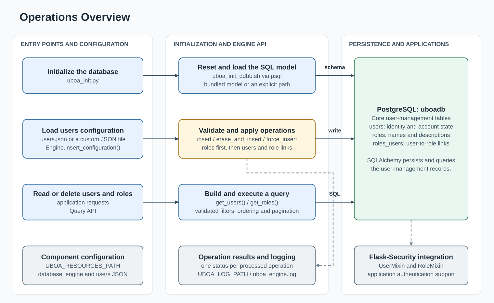
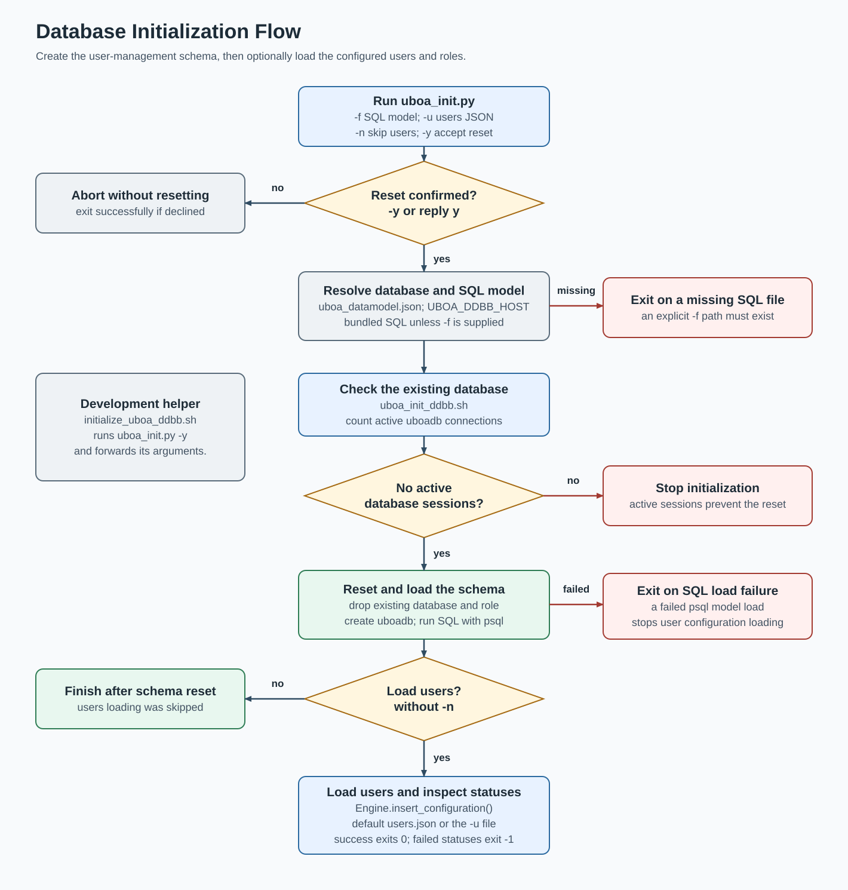
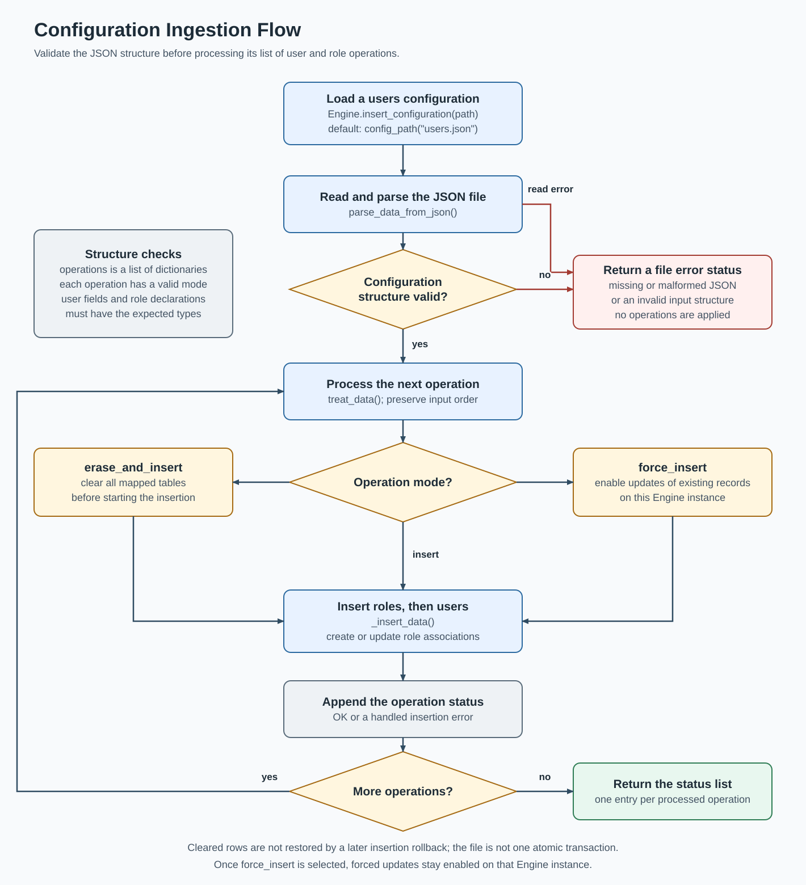
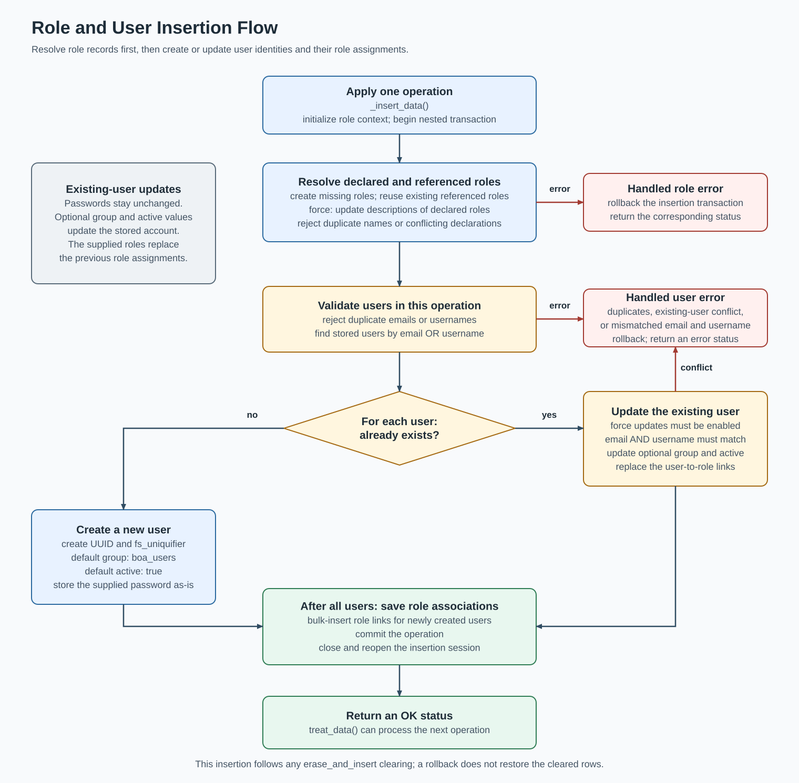
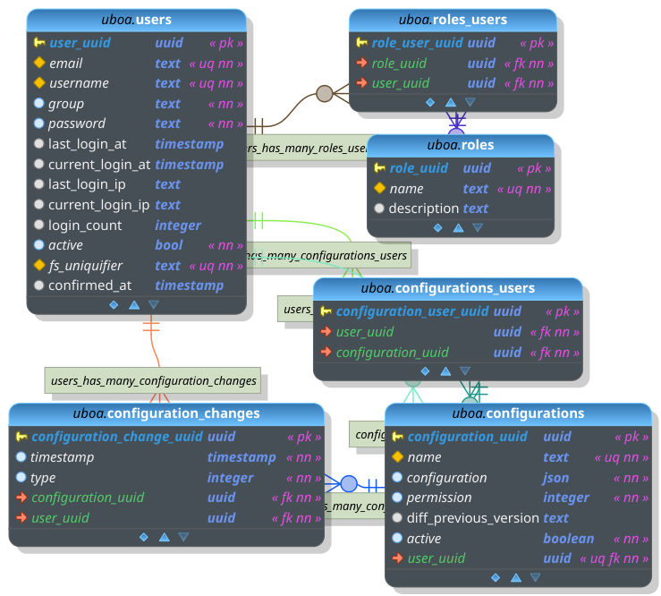

# UBOA: Users management for Business Operation Analysis

UBOA is the user-management component of the BOA suite. It loads users and roles
from JSON configuration and stores them in PostgreSQL. Its SQLAlchemy models
integrate with Flask-Security.

## Operation Flow Schematics

### Operations Overview

UBOA initializes the users database, loads users and roles from JSON, and
exposes filtered queries through its SQLAlchemy models. Applications use
the persisted users and roles with Flask-Security.



### Database Initialization

`uboa_init.py` confirms the reset, resolves the database settings and SQL model,
and invokes `uboa_init_ddbb.sh`. Active database sessions prevent the reset.
After loading the schema, it optionally loads the users configuration; `-n`
skips this step. A user-loading failure leaves the database reset in place.



### Configuration Ingestion

`Engine.insert_configuration()` reads and validates the JSON structure, then
processes operations in input order. `erase_and_insert` clears mapped tables
before insertion, so a later rollback does not restore those rows. Selecting
`force_insert` keeps forced updates enabled on that Engine instance. Handled
insertion errors produce operation statuses and processing continues.



### Role and User Insertion

Each operation resolves declared and referenced roles before processing users
and their role assignments. Forced user updates require matching email and
username, preserve the stored password, and replace role assignments. Handled
insertion errors roll back the insertion transaction and return an error status.



## Database model



## Repository structure

The layout follows SBOA and the conventions of the BOA suite:

```text
src/
  uboa/
    common/        # Standalone command execution helpers
    config/        # Logging, database and users configuration templates
    datamodel/     # SQLAlchemy models and PostgreSQL SQL model
    engine/        # Users configuration, validation and query API
    scripts/       # Database initialization and development startup
  tests/
    unit/          # Database-free model, validation, CLI and runtime tests
    integration/   # PostgreSQL query and update regression tests
    json_inputs/   # Users configuration test fixtures
doc/
  fig/             # Database schema and SVG operation flow diagrams
  publishing.md
tools/            # Distribution and installed-resource checks
```

Package metadata and the release version live in `pyproject.toml`. Runtime
assets are bundled inside `uboa`; tests stay in `src/tests` and are excluded
from both the wheel and source distribution.

## Install

Install UBOA and its test dependencies from this checkout:

```bash
python -m pip install -e '.[tests]'
```

The distribution provides `uboa_init.py`, `uboa_init_ddbb.sh` and the development
helpers `initialize_uboa_ddbb.sh` and `start_uboa.sh`. SQL models and configuration
templates can be located with `importlib.resources.files("uboa")`.

## Configuration

Configure a UBOA resource directory with your database and users settings:

```bash
export UBOA_DATA_PATH="$(python -c 'from importlib.resources import files; print(files("uboa"))')"
export UBOA_RESOURCES_PATH="$PWD/uboa-state"
export UBOA_LOG_PATH="$PWD/uboa-log"
mkdir -p "$UBOA_RESOURCES_PATH" "$UBOA_LOG_PATH"
cp "$UBOA_DATA_PATH"/config/* "$UBOA_RESOURCES_PATH/"
```

`UBOA_RESOURCES_PATH` contains `engine.json`, `uboa_datamodel.json` and
`users.json`. It defaults to the bundled `uboa/config` directory. An explicitly
configured directory must exist. Put customized UBOA configuration files in
`UBOA_RESOURCES_PATH`.

Logging uses `engine.json` in `UBOA_RESOURCES_PATH`. Set `UBOA_LOG_PATH` to the
log directory (default `/tmp/uboa_log`); UBOA creates it when needed.
`UBOA_LOG_LEVEL`, `UBOA_LOG_MAX_BYTES` and `UBOA_LOG_MAX_BACKUP` override the
JSON logging settings. Set `UBOA_STREAM_LOG` to also log to the console.

Set `UBOA_DDBB_HOST` for the users database host. Initialize it with
`uboa_init.py`; use `-n` to omit loading the bundled users template or
`-u /path/to/users.json` to load a custom configuration. Review `users.json`
before using it outside development.

Database initializers require the PostgreSQL client (`psql`). They use the
bundled SQL model by default and accept `-f /path/to/model.sql` to override it.
`uboa_init.py` requests confirmation before resetting a database.
`initialize_uboa_ddbb.sh` accepts the reset automatically for development tests.

## Development and tests

Run the database-free tests and generate a coverage report from the repository
root after installing the test dependencies:

```bash
python -m pytest -m 'not integration' --cov=uboa --cov-report=term-missing --cov-report=html
```

Open `src/tests/tmp/code_coverage_analysis/index.html` for the detailed report.
Tests that require PostgreSQL carry the `integration` marker. They use the
dedicated `uboadb` database and clear user-management tables between tests.
The full suite covers every statement and branch in `uboa`. The integration
workflow enforces 100% coverage; the database-free subset reports its own
coverage without this threshold.

Start the local development environment and run the complete suite:

```bash
UID_HOST_USER=$(id -u) GID_HOST_USER=$(id -g) docker compose -f compose_dev.yml up --build -d --wait
docker compose -f compose_dev.yml exec -T uboa bash -ec 'initialize_uboa_ddbb.sh; cd /uboa; python -m pytest -v src/tests --cov=uboa --cov-report=term-missing --cov-report=html --cov-fail-under=100'
docker compose -f compose_dev.yml down -v
```

`Dockerfile.dev` builds the current checkout and installs UBOA in editable mode.
Compose mounts the checkout at `/uboa`, so source and test edits are visible
immediately. Rebuild after changing dependencies. The container runs as the
`boa` user with the selected host user and group IDs. Configuration in
`/resources_path` links to the checkout's UBOA templates. The database has no
published host ports and joins `boa_network`.

For the GitHub development environment:

```bash
REPOSITORY_URI=https://github.com/danielbrosnan/uboa.git GITHUB_BRANCH=develop \
  docker compose -f compose_github_dev.yml up --build -d --wait
```

`Dockerfile.github.dev` clones the selected repository and branch. Keep
`REPOSITORY_URI` and `GITHUB_BRANCH` set for subsequent Compose commands.
The `uboa-testing.yml` workflow uses this environment. Neither environment
requires a sibling EBOA checkout.

With dependencies and configuration available locally, run `python -m pytest`
from the repository root, or `cd src && python -m pytest tests/`.

## Build and publish

```bash
python -m pip install build twine
python -m build
python -m twine check --strict dist/*
python tools/check_distribution.py dist
```

Start with an empty `dist` directory for each build. The packaging workflow
checks installed wheels and source distributions on Python 3.9 and 3.11 and
runs the database-free tests. See [Publishing UBOA](doc/publishing.md) for
release instructions and installed-resource checks.
